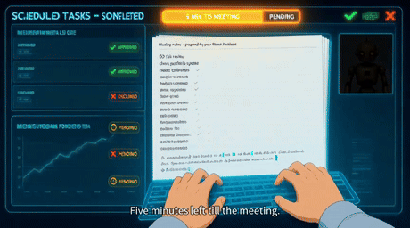

# A_director — one GPU, two tenants, one video pipeline

Architecture notes and the core code for a two-box setup that renders short films
with **MiniMax H3** on a single AMD GPU that is *also* the machine's LLM server.

> ### ⚠️ Third-party models — and what they output — are not MIT
>
> **Everything this pipeline generates is governed by the licences of the models that
> produced it, not by this repository's MIT licence.** Nothing here grants you any right
> to a model weight, to a model's output, or to a voice. Before running any of it — and
> before publishing or monetising anything it produces — read and comply with the licence
> and terms of use of **every model you actually invoke**, including the generation
> checkpoints, their encoders and the serving software. See
> [Models and their licences](#models-and-their-licences) for the list and what is known.
>
> Two consequences people get wrong:
>
> * **a non-commercial model's output does not become commercial by post-processing it.**
>   Mixing, re-encoding, subtitling or re-scoring a clip does not launder its licence.
> * **a cloned voice needs the speaker's consent** — from whoever the reference clip is
>   of, including you. That is a separate obligation from any model licence.
>
> You are responsible for that compliance. This is not legal advice; if a licence is
> unclear, do not ship the result.

---

## ▶ The film



*That loop plays inline — 6 s of the film, silent.* The full cut, with narration, score
and subtitles: **[`sample/imagine_2035_final_v27+brand-vo-v04en-e3.mp4`](sample/imagine_2035_final_v27+brand-vo-v04en-e3.mp4)**
— the delivered film, shipped here as the reference for what comes out the other end.

| | |
|---|---|
| duration | **99.96 s** (1:40) |
| container / codecs | MP4, **H.264** (`avc1`) + **AAC** (`mp4a`) |
| size / bitrate | 19.4 MB, ≈1.6 Mbps |
| what it is | animated shots + cloned-voice narration + generated score + burned subtitles, all from this pipeline |

*(Container facts parsed directly from `moov`/`mvhd` — no media tooling needed. The
≈1.6 Mbps is the burn recipe's `-b:v 1600k` showing up exactly, see
[Combination](#5-combination--the-film-build-ladder).)*

> **Why a GIF instead of the film itself?** GitHub will not play a video that is committed
> to a repository: `<video>` is stripped from markdown, and a committed `.mp4` only plays
> one click away on its own file page. A GIF is the only thing that animates inline from a
> plain `git push`, so the loop leads and the audio stays one click away. If you want the
> **full cut with sound inline**, drag `sample/imagine_2035_final_v27+brand-vo-v04en-e3.mp4`
> into the README editor on github.com once and replace the GIF line above with the
> `user-attachments` URL it returns — nothing else needs to change.

### Licence

**The code and documents here are MIT** — see [LICENSE](LICENSE).

**The sample film is not MIT.** Its score was generated with `m-a-p/YuE2-3B`
(**CC-BY-NC-4.0**) and its narration is a voice clone rendered with Qwen3-TTS, so the
clip is published as a **non-commercial technical sample**. Clear both licences before
any commercial use of anything derived from it. MIT here covers `code/`, `tools/` and
this README — it cannot grant rights the pipeline never owned.

### Models and their licences

This repository **ships no model weights, no voice reference audio and no training data**
— only orchestration code and one sample clip. Every model below is downloaded and run
under its own terms by whoever runs it, and its output inherits those terms. Licences
change; re-check each one at the upstream source before every release, and treat the
"verify" rows as unpaid homework, not as clean passes.

| component | what it does here | licence status |
|---|---|---|
| **MiniMax H3** (`minimax_h3_fl2va_pruned_bf16`) | video + stereo audio generation | MiniMax model terms — **verify** |
| its text encoder — Qwen3-VL-32B, truncated to 50 language layers | encodes every prompt that shapes a frame | Qwen terms — **verify** |
| **Qwen-Image-2.1-Turbo** (`qimg`) | keyframe generation | Qwen terms — **verify** |
| **Qwen3-TTS** 1.7B (base / customvoice / voicedesign) | narration, incl. **voice cloning** | Qwen terms — **verify** + the speaker's consent |
| **m-a-p/YuE2-3B** + `YuE2-Vae` | the score | **CC-BY-NC-4.0** — non-commercial |
| the served LLM checkpoints (`:8080`) | the tenant H3 displaces | checkpoint terms — **verify** |
| **this repository** (`code/`, `tools/`, docs) | orchestration only | **MIT** |

Practical reading: the *code* is free to use, the *outputs* are not automatically yours to
sell, and the sample film is explicitly non-commercial. Attribution obligations attach to
several of these at once — when you publish a cut, you are redistributing the work of at
least a video model, a speech synthesiser and a music model.

---

# How I'd direct a film — recommendations

Nothing here is a requirement. These are recommendations: what I now do by habit, and what
I'd tell a friend who was starting their first film on a machine like this one. The exact
commands for each step live in [Part I](#part-i--directing-with-it).

**The one idea underneath all of it:** you are the director, and the models are a very fast,
very literal crew. They do exactly what you ask, immediately, and they have no opinion about
whether the result is good. So my usual approach is to spend as much as I like on the cheap
steps, and pay for the expensive one only once.

### 1. I'd start with a story from a language model — then cut it in half

I usually ask for a logline and a beat sheet for a **60–120 second** film with one turn at
the end, and ask the model to say that turn in a single sentence. If it can't be said in one
sentence, I've found it isn't one film yet.

Then I tend to delete about half the beats. Words are free and video is not, so it's worth
having the argument with the language model rather than with the render queue.

> **A second use for the same model:** paste the finished shot list back in and ask which
> shots are redundant and what you'd cut to reach 90 seconds. It's often a better editor
> than it is a writer.

### 2. I'd turn it into a numbered shot list

What works for me is **10–15 shots, one line each**: who is in frame, where, what moves, how
long it should feel. I keep that list as a plain text file, because it's the one document
every later step reads — and the one you'll be glad of on shot eleven at midnight.

It also helps to write one short paragraph describing the character (clothes, hair, glasses,
build) and paste it into every shot that doesn't continue from the previous one. Shots that
do continue usually inherit the previous shot's last frame instead, which is what actually
keeps a character looking like the same person.

### 3. I'd draw it before filming it

I generate four to six stills of the main character and of the two or three key scenes, then
pick. A still costs **tens of seconds**; a bad shot costs **ten minutes**. In my experience
this is the cheapest step on the list and the one people most often skip.

### 4. I'd record the voice before cutting the picture

Voicing first has saved me more time than anything else: two or three reads of every line,
then pick the ones you'd want to hear. Once the takes exist their lengths are real, and the
picture gets cut to them.

If you re-record after cutting, you'll re-time every subtitle and music cue placed
afterwards — so the order is worth keeping.

### 5. I'd render short takes, and more than one of each

This is the expensive step, so it helps to budget it like money:

| a take of | costs about | I'd use it for |
|---|---|---|
| 5 seconds | **~10 minutes** | trying things out |
| 10 seconds | **~36 minutes** | only a shot you'd defend |

For a single shot my habit is three 5-second variations (~30 min), keep the best, and only
then consider the 10-second version. I'd avoid rendering a long take of a shot you haven't
seen at five seconds yet.

A few things that have saved me real time here:

* **Batching rather than dripping.** The machine has to swap models before the first job and
  after the last, so six shots in one batch pay that swap once; six separate requests pay it
  six times.
* **Same words, different seed.** If a face or a hand looks wrong, it's often cheaper to
  re-render the same description on another seed than to rewrite it — a rewrite usually
  fixes one thing and moves two.
* **Keeping the rejects.** Not for sentiment: after twenty rejects you can usually see what
  the model gets wrong systematically, and that's a good hint for what the next shot list
  shouldn't ask for.

### 6. I'd do the music last, and keep it plain

Five to ten short cues on different seeds or styles, then pick one — each costs minutes, and
choosing is easier than designing. For a short film, one cue looped and faded is usually the
right answer. I'd keep its level behind a single number, so turning it down later is a
one-character edit.

### 7. Subtitles are worth taking from the finished audio

Rather than from the script, and rather than by hand: measure where the speech actually
starts and stops in the rendered audio and build the cues from that. Hand-timing tends to
drift the moment a line is re-recorded.

### 8. I'd combine in the cheap order

Assemble first without touching the picture at all, watch it **start to finish**, fix the
audio until it's right — and only then burn in subtitles or overlays, once, since that step
re-encodes the whole film. Burning early usually means burning again for every later tweak.

### 9. I'd watch it twice before believing it

Full screen once, then **on a phone**. The phone pass tends to find every subtitle that's too
small and every line that's too quiet. And on a burn, it's worth pulling out a couple of
frames and looking at them instead of trusting a "success" message.

### Naming

* **I don't overwrite.** `v2`, `v3`, `v4` alongside `v1` — the favourite is often the third
  one, and there's no way to know which in advance.

---

# Part I — Directing with it

The guide above is *what* to do and in what order; this is *how*, with the commands and the
measured numbers behind each stage.

Three things are true of every stage and they
explain the shape of all the commands:

* **every stage is a one-shot process that exits.** Nothing resident — the host's swap
  gate refuses to start a tenant while anything extra holds memory, so a leftover process
  is not untidy, it blocks the next render.
* **the handover is the expensive operation**, not the prompt. Batching exists to pay it
  once.
* **nothing is judged by an exit code.** Each stage's output is checked as an artefact.

```
shot list → keyframes → shots → narration → score → subtitles → mux → burn → deliver
   ①          ②          ③         ④           ⑤         ⑥         ⑦      ⑧       ⑨
```

## 1. Video creation

Two entry points, and the difference is the handover.

```bash
# one shot, full cycle: LLM down → H3 up → render → clip archived → LLM back up
vgen render "<shot description>" --seconds 5 --w 864 --h 480 --name s07-desk

# N shots, ONE handover. "description<TAB>extra args" per line.
vgen batch --file shots.txt

# a named shot list that lives on the host, stitched afterwards
vgen film --film <film-name>

# plan without touching the GPU
vgen render "…" --seconds 5 --dry-run
```

`--keep-llm-down` chains several batches while the LLM stays off, paying the handover
once for the whole session instead of once per batch.

**The take length is a budget decision, not a taste one.** Sampling cost is ~quadratic
up to 124 frames and then collapses (exponent ≈3.37 above it):

| frames | video | wall time | you should read that as |
|---|---|---|---|
| 56 | 2.3 s | 4 m 03 s | a plumbing test |
| 124 | 5.2 s | **10 m 30 s** | **the unit of exploration** |
| 243 | 10.1 s | **36 m 17 s** | a promoted shot only |

So: explore at 5 s, promote to 10 s. A 10-second take costs 3.5× a 5-second one, not 2×.

**Character consistency across shots** is carried by pixels, not by repeating a
description. A chained shot starts from the previous shot's **last frame**; a new shot
renders from text. For a hero shot you can seed it explicitly:

```bash
animate --first-frame <keyframe.png> "<motion for this shot>"
```

Keyframes come from the image stage (`qimg`, Qwen-Image-2.1-Turbo, **34 s per
1152×640**), which — unlike H3 — runs **alongside** the resident LLM. Generating a
hundred keyframes therefore costs no handovers at all, which is why storyboarding is
cheap and re-rendering is not.

## 2. Narrative creation

The audio bench is `sound`, eight one-shot subcommands, each in its own container:

```bash
sound status / doctor                     # what is hosted; ROCm + ffmpeg + imports
sound say  "<line>" --ref <your-reference.wav> --name take07   # narration in a cloned voice
sound cv   "<line>" --voice <preset>       # preset voices, with style/emotion instruct
sound design "<line>" --describe "…"       # a voice built from a text description
sound split <clip.mp4>                     # demucs stem separation of a clip's baked track
sound bed …                                # ambience beds
sound lay …                                # voice + beds + kept clip audio + ducked music
```

`sound say` is the spine: one line of narration per take, in a voice cloned from a
reference clip you supply. Measured on this box: model load **2.5 s**, and **10.00 s of
speech rendered in 18 s total while the LLM stayed resident** — narration never needs the
GPU handed over, so you can voice a whole script between two renders.

**Order matters: voice first, then cut.** Take durations are the thing picture gets cut
to, so voicing happens before the edit is locked — re-voicing after locking means
re-cutting picture, and re-cutting picture means re-timing every subtitle cue later.
Bake nothing until the read is final.

One trap worth naming: each H3 clip arrives with **one baked audio track**, and each
clip's ambience is independently invented by the model. You cannot inherit a coherent
soundtrack from the shots, which is why the soundtrack is *built* (`sound lay`) rather
than collected. `sound split` exists for the parts of the baked track you do want —
`sound lay` measured **−14.0 LUFS / −1.0 dBTP** on delivery.

## 3. Music creation

The score is generated, and the queue is data:

```bash
bin/music-batch [spec-file]      # default: out/styles/specs.txt
```

A spec file is one cue per line — `<variation>:<style-file>:<seed>[:<output-dir>]`
(see `bin/music-specs` for a 30-cue example). A cue counts as **done** only when
`<output>/listen/listening.mp3` exists, so the driver is re-runnable: kill it, re-run
it, and it finishes what is missing without repeating what landed. That property is what
makes a 30-cue hunt on a shared GPU tolerable.

Two constraints the driver encodes, both measured:

* **one GPU job at a time.** YuE2 peaks at **11.18 GiB** while the resident LLM leaves
  ~**18.21 GiB** free — it fits, but only alongside the LLM and only one at a time.
* **the image's torch, not PyPI's.** PyPI's recipe-pinned `torch 2.10.0+rocm7.1`
  segfaults on gfx1151 at the first device allocation; the driver runs the image's
  `2.14.0a0+rocm7.15` with `yue2` from a `--no-deps` install so nothing shadows it.

Style is a text file per variation, seed is an integer, and re-tuning a finished mix is
deliberately one number in one script (see the gain dial in
[Combination](#5-combination--the-film-build-ladder)).

## 4. Subtitle creation

**Cue times are measured, never assumed.** You do not hand-time subtitles and you do not
trust the script's line lengths — you detect where the rendered speech actually is:

```bash
ffmpeg -i take07.wav -af silencedetect=noise=-40dB:d=0.12 -f null -
# cue = slot start + first speech onset … last voiced segment end
```

One cue per line for an English set; for CJK, split at phrase boundaries (22 cues for
the Chinese ladder). Font for burns: `NotoSansCJKsc-Regular.otf`.

Then there are two kinds of subtitle, and they belong to different stages of the build:

| | mechanism | when |
|---|---|---|
| **soft** | a `mov_text` track added to the muxed file | whenever — costs nothing, picture untouched |
| **burned** | `-vf "subtitles=…:force_style=…,drawtext=…"` in the same pass as the audio mux | **only after the audio is final** |

Burning is a full re-encode of the picture, so burning early means burning again for
every audio revision you touch afterwards. That single ordering rule is most of the
delivery cost.

And a burn is verified by **looking**, not by a clean exit: extract a frame with a
subtitle active, one without, and one during any watermark beat. A filter string that
silently no-ops produces a perfect-looking encode of the wrong picture.

## 5. Combination — the film-build ladder

The final assembly is a ladder of builds over **one picture carrier**, and the order of
operations is the whole design. Two build orders, both starting from the same video:

**soft build** — no re-encode at all:

```
-map 0:v:0 -i mix.mp3 -map 1:a:0  -c:v copy -c:a copy        then add mov_text subs
```

Picture stays byte-identical, and that claim is *audited*, not assumed: the H.264
elementary-stream md5 of the carrier must not move across audio revisions. If the hash
moved, something re-encoded the picture and the ladder is broken.

**burned build** — one pass, because the subtitle burn and the audio mux share it:

```
-vf "subtitles=…:force_style=…,drawtext=…"
-c:v libopenh264 -b:v 1600k -profile:v high -pix_fmt yuv420p     # no libx264 in the container ffmpeg
-movflags +faststart
```

The audio that gets muxed in is itself a chain, and its order is load-bearing:

```
voice   : highpass=f=90 → acompressor=-18dB:3:8:120
music   : cue taken from its own 63 s mark → volume=<dial> → afade out
ambience: native clip track at volume 0.12
mix     : amix normalize=0 → alimiter limit=0.95 → loudnorm I=-14:TP=-1.0:LRA=11
          → libmp3lame 192k 48k
```

`amix normalize=0` matters — with normalisation on, the mix silently re-balances itself
whenever you add a stem, and the loudness you approved is gone. The music level sits
behind **one dial** (currently `0.25`; it has been `0.50` and `0.35`) in a rebuild script
that stays on the host, because re-tuning a mix must be cheap enough that you actually
re-tune it.

**Nothing superseded is ever overwritten.** Previous encodes become `*.vN.mp4` in an
archive directory, previous mixes likewise, and the record points at the live file while
listing the archived ones with their md5s. Everything that ships is md5-verified after
transfer. The English line of the sample above is
`e3 → v1 → v2 → v3 → v4` — four builds of a delivery, none of them a rewrite.

## Ordering rules that save days

1. **Storyboard at 5 s, promote at 10 s** — the cost curve is not linear.
2. **Keyframes before shots** — the image stage coexists with the LLM, so it is free of handovers.
3. **Voice before picture lock** — take durations drive the cut.
4. **Audio final before any burn** — a burn is a re-encode of the whole picture.
5. **Soft first, burned last** — cheap ladder rungs first, expensive one last.
6. **Verify with artefacts and hashes**, at every rung: the clip, the md5, the extracted frame.

---

# Part II — How it works

## The constraint that shapes everything

| | role | notes |
|---|---|---|
| **workstation** `192.0.2.158` | drives the pipeline, archives clips, serves the dashboard, holds a small local standby model | consumer GPUs, no `ffmpeg`/`ffprobe` installed on purpose |
| **model host** `192.0.2.59` | every heavy model | 122 GiB unified AMD memory (gfx1151), rootless podman, no passwordless sudo |

One GPU, **one tenant at a time**:

```
        ┌──────────────── model host ────────────────┐
        │                                            │
        │   LLM        :8080   ┐                     │
        │                      ├─ mutually exclusive │
        │   MiniMax H3 :8189   ┘  (~57.5 GiB weights)│
        └────────────────────────────────────────────┘
```

H3's weights cannot coexist with the LLM, so **every render is a full handover**:

```
llm down → video up → render → clip archived → llm up
```

Two consequences that drive the whole design:

* a render is a *state transition*, not a command — it can be interrupted at any arrow
* the box is shared with the user's own work, so an interrupted handover is a bug report,
  not an inconvenience

## Model swapping — `code/host-reset.sh`

The host-side primitive. It hands the GPU over from whatever holds it, **proves** the
memory came back, and only then starts one named tenant.

```
host-reset.sh status          containers, units, servers, memory   (no change)
host-reset.sh stop            release everything, verify, start nothing
host-reset.sh abl | stock     release everything, start that LLM checkpoint
host-reset.sh video           release everything, start the MiniMax H3 node
host-reset.sh ... --dry-run   print every action, change nothing
host-reset.sh ... --force     also TERM/KILL host servers no container owns
```

Three rules, each learned expensively:

**1. Stop each container through whatever owns it.**
A systemd user unit is stopped with `systemctl --user` — its `ExecStop` knows the grace
period. Launcher-owned containers are stopped *and removed* after their log is saved,
because a launcher refuses to run over a dead container of its own name: there,
"stopped" is not "released". Unit-owned containers are only ever stopped, because
removing one breaks the unit that starts it with `podman start`.

**2. Nothing new starts until memory is measurably free.** Not assumed — polled:

```bash
GTT_MAX_GIB=2      # device memory tolerated when "released"
MEM_FLOOR_GIB=110  # RAM required before a 57 GiB model starts
```

`verify_released()` reads `mem_info_gtt_used` and `MemAvailable` in a loop until both
clear, and says so in the log:

```
released: gtt 1.8 GiB (limit 2), MemAvailable 118.4 GiB (floor 110) in 11s
```

A container podman has forgotten can still leave the AMD driver holding device memory —
that is how a box refuses a model it plainly has room for. Cache reclaim needs root, so
`drop_caches` runs only when `sudo -n` works; otherwise the shortfall is reported
rather than hidden.

**3. Starting is confirmed by published identity, not liveness.**
After a swap, the script polls `GET :8080/v1/models` until the returned model id
*contains the expected string* — and dies if it answers as anything else:

```
FAIL: started but answers as '<other-checkpoint>', expected a model containing 'Abliterated'
```

An abliterated box must never come back serving the stock checkpoint, silently.

**Why it is a script and not a systemd unit:** a swap happens only when a human asks.
Nothing here auto-starts an LLM — no unit, no cron, no boot hook. That is a deliberate
invariant, because the box is shared with interactive work.

## Run lifecycle — `code/vgen`

Runs on the workstation, drives the host over ssh. Owns the whole cycle above.

```
vgen render "…" --seconds 5            one clip; --dry-run to plan
vgen batch --file shots.txt            N prompts, ONE handover
vgen film --film <name>                a shot list from the host, stitched after
vgen status | facts | doctor           state, machine-readable state, preflight
vgen progress | watch | dash           is a render running, and how far along
vgen collect [run-id]                  fetch clips a finished run left on the host
vgen abort                             stop a runaway batch, keep the clips
vgen heal                              finish an interrupted handover (idempotent)
vgen recover                           abort → collect → heal, in one call
```

Three rules this script exists to enforce:

**1. Restore the model that was actually live, not the one a state file prefers.**
The published id is captured *before* anything is stopped and compared afterwards.

**2. A render is finished when the artefact appears — never by the clock, never by an
ssh exit code.** The work is detached on the host, which records its own return code;
completion is the clip showing up in `out/`. The ssh tunnel may die at any point without
changing either the outcome or the verdict.

**3. Never leave the box in a state nobody can finish.** The owed variant is written to
the host *before* anything is stopped, so `vgen heal` — or, with no workstation at all,
`~/host-reset.sh abl` on the host — closes the handover. Both are idempotent converges,
not a replay of a half-run sequence.

> **Why it is built this way.** Measured 2026-10-25: the WiFi link between the two boxes
> dropped for ~10 minutes in the middle of a 4-minute render. The clip was produced, the
> ssh carrying it was not, and the single best-effort restore that followed ran over that
> same dead tunnel — so a successful render was reported failed and the LLM stayed down
> until it was started by hand. Every rule above is the fix for that afternoon.

A related consequence: the workstation has no `ffmpeg`/`ffprobe`. Media is probed where
the tools live, and only verdicts cross the wire.

## The render node — `code/animate`

Renders one H3 clip (video **and** stereo audio) against the local ComfyUI
(`127.0.0.1:8189`). Prints the output path on the last line of stdout and timing on
stderr, so it composes: `play "$(animate --seconds 2 '…')"`.

Notes that matter to anyone touching the graph:

* **Do not poll ComfyUI's HTTP while it is sampling.** It does not answer, and each poll
  stalls 18–43 s. `animate` polls at 45 s with 10 retries for exactly this reason.
* `CLIPLoader type` **must** be `minimax`. The text encoder is a Qwen3-VL-32B truncated to
  50 language layers, exported without the final LM norm, vision tower and three DeepStack
  mergers intact. A generic Qwen3-VL will not substitute — and the wrong type fails at
  tokenize time, not load time.
* `cfg` is **1.0 and is not a stylistic choice**: H3 is distilled and cfg-free. The negative
  branch is never evaluated at 1.0, which is why it is wired to the positive conditioning —
  KSampler's schema still requires the input.
* The AV latent is a `NestedTensor` pair — video `[B,24,T,H/16,W/16]` plus audio
  `[B,32,2,T40]` — decoded by **two different VAEs**, so one sampler feeds both a
  `VAEDecode` and a `VAEDecodeAudio`. Frames snap up to a `17k+5` grid at 24 fps.
* `shift_video`/`shift_audio` (defaults 12.0/3.0) drive the flow schedule *and* are handed
  to the DiT, which derives the audio schedule from the video one. Changing one without the
  other desyncs sound from picture.
* `SaveVideo` needs `codec` as well as `format` on ComfyUI 0.31; omitting it executes every
  other node and then fails at the write.

## Measured cost (864×480, `--turbo 4step`, first-frame, with audio)

| frames | seconds of video | wall | sampling | non-sampler |
|---|---|---|---|---|
| 56 | 2.3 s | 4 m 03 s | 0:55 | 3:08 |
| 124 | 5.2 s | **10 m 30 s** | 4:49 | 5:40 |
| 243 | 10.1 s | **36 m 17 s** | 23:52 | 12:25 |

Sampling grows ~quadratic **up to 124 frames and then collapses** (exponent ≈3.37 above
it). Non-sampler work is linear at ~3 s/frame. The practical rule: short takes are the
unit of exploration, long takes are for a shot that has already earned it.

Measured and **closed** — do not re-try, each cost hours: `<4` steps, `--cache-none`
(forces a full weight reload per job), 1344×768 (54 min, then out of RAM), parallel
renders (one job already holds ~54–64 GiB of GTT), INT8 attention on the `hip` backend
(no attention capability there), and `HIP_FORCE_DEV_KERNARG` + `expandable_segments`
(null on H3, −33% elsewhere).

## The dashboard

`vgen dash` for the terminal; a small Python server for the browser. Two design points
worth keeping:

* the page is rendered from a **cached** reading refreshed by one background poll, so a
  page full of viewers costs one ssh round-trip per poll instead of one per refresh, and
  an unreachable host shows as a *stale reading with its age* instead of a broken page
* it binds to a VPN-only address by default and **refuses `0.0.0.0`** — the page shows
  model paths, run state and a button that starts a process

## Layout

```
A_director/
  README.md
  LICENSE               MIT — code and docs only, see the note above
  code/host-reset.sh    host-side tenant swap + proof gate
  code/vgen             run lifecycle: render, batch, collect, heal, recover
  code/animate          single H3 clip render against local ComfyUI
  sample/               the one delivered clip, as a reference
  assets/preview.gif    the 6 s silent loop shown inline above
  tools/publish-check.sh  leak gate run before every push
```

**Documented but not shipped here:** the image stage (`qimg`), the audio bench (`sound`)
and the music driver (`music-batch` / `music-specs`) are described by their interfaces in
[Part I](#part-i--directing-with-it) — they are host-side one-shot containers and this
repository carries only the three scripts that own the GPU handover.

### Reuse

Both long scripts read their environment, so they are portable to any host with an AMD
GPU of the same class:

| variable | default | meaning |
|---|---|---|
| `NUCBOX_HOST` | `model-host` | ssh alias of the model host |
| `MODEL_PORT` | `8080` | OpenAI-compatible port the swap must confirm on |
| `VIDEO_SANDBOX` | `~/Video_Sandbox` | where the ComfyUI node lives |
| `VIDEO_COMFY` | `127.0.0.1:8189` | ComfyUI address for `animate` |
| `VIDEO_CONTAINER` | `video-comfy` | container name the video tenant runs in |
| `GTT_MAX_GIB` / `MEM_FLOOR_GIB` | `2` / `110` | the release proof thresholds |

Addresses in `code/` are placeholders from RFC 5737 documentation space, and the ssh
alias is neutralised; container and unit names are the real ones.

## The short version

1. **One tenant at a time, and prove the handover with measurements** — `gtt` and
   `MemAvailable`, plus the published model id. Never trust an exit code.
2. **Completion is an artefact.** The clip appearing in `out/`, not a log line.
3. **Every state must be finishable by someone.** Write what you owe before you take the
   GPU, so recovery is an idempotent converge rather than a replay.
4. **Order the ladder by cost.** Voice before cut, audio before burn, soft before burned.
5. **MIT covers the code, not the models or their outputs.** Check every upstream
   licence before you publish anything this pipeline made.
